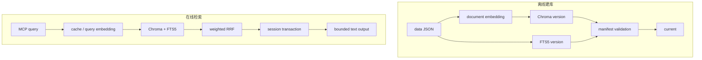

系统把昂贵且可重建的论文索引，与小而频繁写入的 runtime state 分开管理。这个边界让查询保持本地化，也使备份、只读挂载和失败恢复更清晰。

## 四个层次

| 层次 | 组件 | 关键职责 |
|---|---|---|
| 语料 | `data/*.json` | 提供 6,341 篇论文的权威静态快照 |
| 索引 | Chroma、FTS5、manifest | 生成候选、融合排名、验证版本一致性 |
| 业务 | `PaperSearchService` | 参数边界、过滤、session 原子提交 |
| 传输 | FastMCP、HTTP health | MCP schema、身份、并发 admission、公开错误 |

## 离线与在线路径

服务启动、`info`、preflight 和 readiness 都不访问 DashScope。在线 query 只有在 embedding cache 未命中时才访问 provider。

## 单进程边界

Chroma 本地持久化目录不是服务端向量数据库。一个应用进程负责打开它；同步 Chroma、FTS5、SQLite 和 provider 调用由 async MCP handler offload 到有界线程池。

需要多节点或多个 writer 时，应迁移到支持服务端并发的向量数据库，而不是让多个 worker 共享目录。

## 代码依赖方向

`server.py` 和 `cli.py` 调用 `service.py`；service 依赖 `SearchEngine`、`TextEncoder` 与 `SessionStore` 协议。具体 Chroma、DashScope 和 SQLite 实现留在协议之后，因此离线测试可以注入替身，不访问外部服务。
