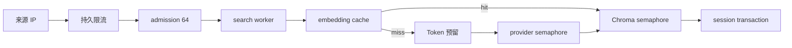

公共实例面向 25–40 名间歇使用者，而不是 25–40 个持续占满的并行搜索。治理层的目标是让昂贵调用、阻塞组件和匿名调用方都保持有界。

## 请求路径

## 分层边界

| 边界 | 保护对象 |
|---|---|
| 每 IP / 全局速率 | 防止单一调用方占满共享实例 |
| active + waiting admission | 防止请求无限堆积 |
| search / state limiter | 隔离慢检索和轻量状态操作 |
| provider / Chroma semaphore | 限制外部 IO 与本地索引并发 |
| 日/月 Token ledger | 控制在线 embedding 费用 |
| 持久 cache + single-flight | 避免相同 query 重复调用 provider |

限流、预算和 cache 都保存在 runtime SQLite，重启不会重置公共边界。请求取消、超时和异常路径必须释放 admission 名额与明确未发送的预算预留。

## Fail closed

调用可能已经发出但 usage 未知时，系统按预留值结算。实际 usage 超过预留时记录差额，并阻断当日和当月后续在线调用。这个策略优先防止费用继续失控，而不是冒险假设 provider 没有计费。

默认数值和调优方法见[容量规划](/docs/operations/capacity)。
