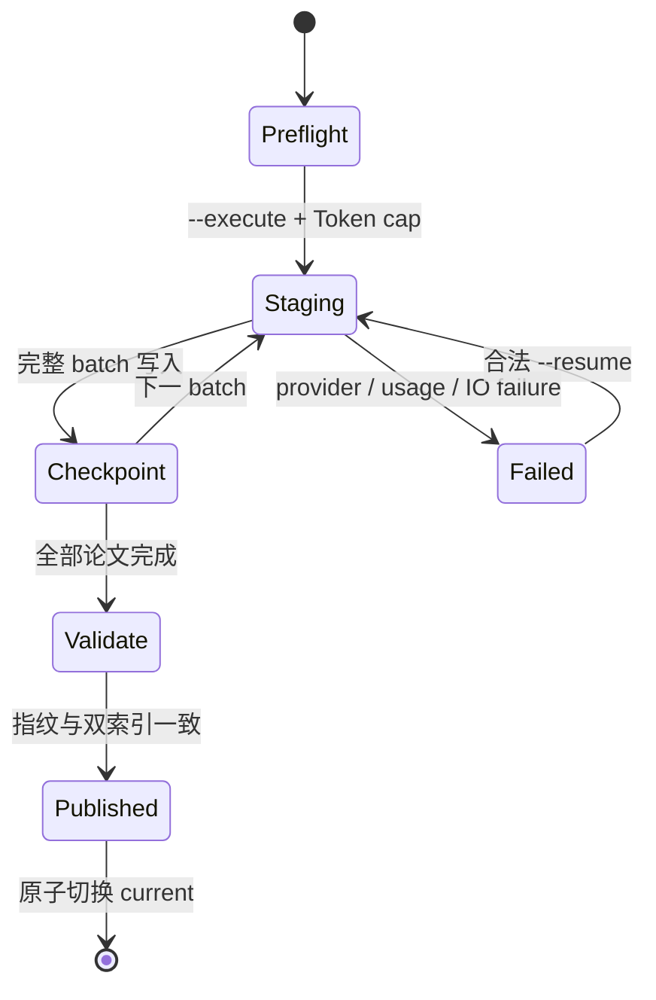

建库会调用付费 embedding provider，因此项目把“计划”和“执行”分开，并把不完整版本隔离在 staging 中。

## 状态机

## Preflight

默认 `icml-papers build` 只读取语料，计算稳定 `build_id`、record count、corpus hash 和保守 Token 上界。它不读取 key、不访问 provider、不产生费用。

## Staging 与 checkpoint

执行模式逐 batch 生成 document embedding，并在完整写入 Chroma 后前移 checkpoint。最后一批会按剩余 Token cap 缩小，避免超出调用前预算。

Provider actual usage 超过预留时，当前 batch 不写入索引或 checkpoint，staging 记录不含原文的 failure audit，并拒绝自动 resume。

## Manifest

一个可发布版本同时绑定：

- 语料文件哈希、corpus hash 和完整 paper-id 指纹；
- embedding 模型、维度、document text type 与 batch 契约；
- Chroma metric、collection metadata 和完整 ID 集合；
- FTS5 tokenizer、记录数、融合权重与 `rrf_k`。

缺少当前契约字段的旧索引不会降级读取，必须显式重建。

## 原子发布

只有 Chroma、FTS5、manifest 和语料指纹全部匹配，版本才进入 `versions/<build_id>` 并切换 `current`。失败构建不会替换已有可用版本。

操作步骤见[重建索引](/docs/guides/rebuild-index)。
