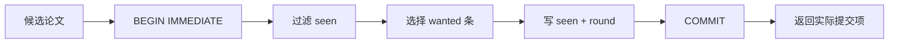

Session 是一个持久化去重集合，不是用户账号或聊天记录。调用方持有的随机 `session_id` 同时充当访问能力。

## Capability 模型

- raw id 至少包含 256-bit 随机性。
- raw id 只在创建时返回，服务端数据库只保存 SHA-256 摘要。
- 拿到 raw id 的人可以访问对应 session。
- 匿名接口不能列举、恢复或搜索其他 session。
- 关闭、过期和不存在统一返回 `session_not_found`。

因此 `session_id` 应像临时凭据一样处理，不进入日志、issue、截图或公开 prompt。

## 原子去重

同一 session 可能被多个请求同时使用。实现不会先读 seen 集合、再异步写回；它在一个 SQLite 事务中完成：

只有最终返回给调用方的论文才登记为 seen。`get_papers` 只有在传入 session 时才登记实际找到的论文。

## 生命周期

默认空闲 24 小时过期。活动 session、总轮次、seen 数、审计记录和关闭汇总都有上限；容量满时拒绝新建，不会淘汰其他调用方仍活跃的 session。

连续空轮在出现新命中后归零；达到配置阈值后 session 标记为 `exhausted`，但调用方仍可换词或调整窗口继续判断。

## 持久化内容

Runtime SQLite 保存 capability hash、标签、时间、seen paper id、有限轮次统计和 query hash。它不保存原始 IP、原始 query 或 raw session id。标签按原样保存，所以标签也不能包含敏感内容。
