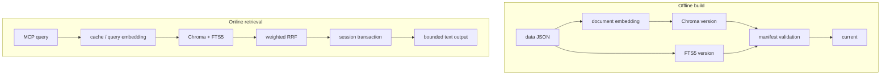

The system separates expensive, reproducible paper indexes from small, frequently written runtime state. This keeps query processing local and makes backup, read-only mounts, and failure recovery explicit.

## Four layers

| Layer | Components | Responsibility |
|---|---|---|
| Corpus | `data/*.json` | Authoritative static snapshot of 6,341 papers |
| Index | Chroma, FTS5, manifest | Candidate generation, fused ranking, version validation |
| Service | `PaperSearchService` | Parameter bounds, filtering, atomic session commits |
| Transport | FastMCP, HTTP health | MCP schema, identity, admission, public errors |

## Offline and online paths

Startup, `info`, preflight, and readiness never contact DashScope. An online query contacts the provider only after an embedding-cache miss.

## Single-process boundary

A local persistent Chroma directory is not a server-side vector database. One application process opens it; async MCP handlers offload synchronous Chroma, FTS5, SQLite, and provider calls to bounded thread pools.

If you need multiple nodes or writers, migrate to a vector database designed for server concurrency instead of sharing the directory among workers.

## Dependency direction

`server.py` and `cli.py` call `service.py`. The service depends on the `SearchEngine`, `TextEncoder`, and `SessionStore` protocols. Chroma, DashScope, and SQLite implementations remain behind those boundaries, so offline tests can inject substitutes without external services.
