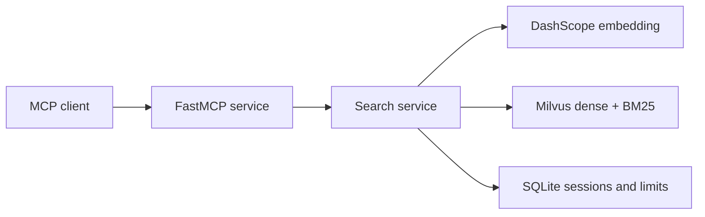

Milvus stores the 6,341 paper records, dense vectors, analyzed text, and metadata filters. It performs both retrieval paths and RRF ranking. SQLite is limited to runtime state: sessions, request counters, provider-minute usage, and the embedding cache.

The Python package separates transport, search, storage, indexing, embeddings, runtime state, domain models, and corpus loading. This keeps new data sources and retrieval changes isolated from MCP transport code.
