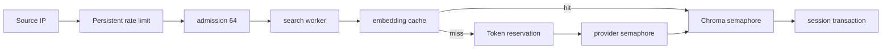

The public instance targets 25–40 intermittent users, not 25–40 continuously saturated search workers. Governance keeps expensive calls, blocking components, and anonymous callers bounded.

## Request path

## Layered boundaries

| Boundary | Protects |
|---|---|
| Per-IP and global rates | Shared capacity from one caller |
| Active + waiting admission | Memory from unbounded queue growth |
| Search and state limiters | Lightweight state work from slow retrieval |
| Provider and Chroma semaphores | External I/O and local-index concurrency |
| Daily/monthly Token ledger | Online embedding spend |
| Persistent cache + single-flight | Provider calls from duplicate queries |

Rate limits, budgets, and cache state live in runtime SQLite and survive restarts. Cancellation, timeout, and error paths release admission slots and reservations for requests known not to have been sent.

## Fail closed

When a call may have been sent but usage is unknown, the service settles the reservation as used. If actual usage exceeds the reservation, it records the overrun and blocks later online calls for the day and month. This prevents continuing spend instead of assuming the provider did not bill.

See [Capacity and concurrency](/en/docs/operations/capacity) for defaults and tuning.
