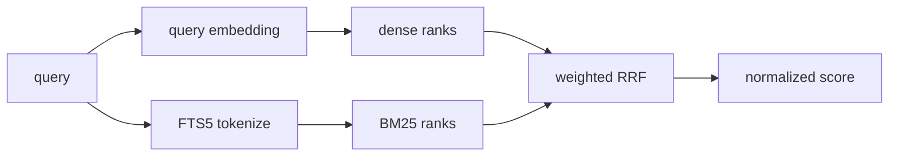

Paper discovery needs both conceptual similarity and exact lexical matches. For each query, the service runs dense and BM25 retrieval once, then combines ranks with weighted reciprocal rank fusion.

## Two retrieval paths

- **Dense**: DashScope creates the query embedding; Chroma COSINE finds semantically related papers.
- **BM25**: SQLite FTS5 matches terms across titles, abstracts, and metadata.
- **Filters**: `area`, `paper_type`, and spotlight semantics are identical in both paths.

The defaults are dense `0.8`, BM25 `0.2`, and `rrf_k=60`. The weights must sum to 1 and are recorded in the index manifest.

## Fixed retrieval window

By default, `search_depth = top_k × 4`, capped by the global maximum. Each retriever runs once. Session deduplication operates inside the fused fixed window and does not descend into weaker results to fill `top_k`.

With `top_k=5, search_depth=20`, repeated calls may return ranks 1–5, 6–10, 11–15, and 16–20, then return empty.

This keeps cost, latency, and relevance boundaries predictable. If too few new results remain, rephrase the query, increase `search_depth`, or stop exploring that direction.

## Interpreting score

`score` is a fused rank normalized to `[0,1]`:

- Use it to order results for the current query.
- Use it for coarse `min_score` filtering.
- Do not treat it as cosine similarity.
- Do not treat it as a relevance probability.
- Do not compare absolute values across queries.

See [Filters and result interpretation](/en/docs/guides/filters-and-scoring).
