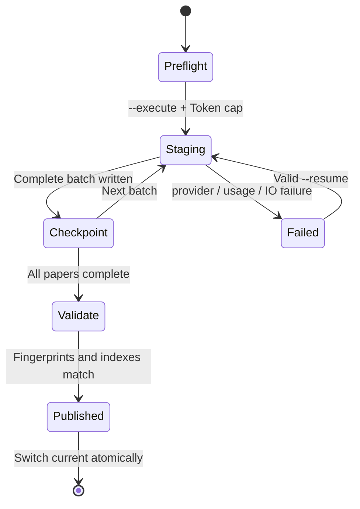

Building the index calls a paid embedding provider. The project separates planning from execution and isolates incomplete versions in staging.

## State machine

## Preflight

The default `icml-papers build` reads the corpus and computes a stable `build_id`, record count, corpus hash, and conservative Token upper bound. It does not read a key, contact the provider, or incur cost.

## Staging and checkpoints

Execution generates document embeddings in batches and advances the checkpoint only after a full Chroma write. The final batch shrinks to fit the remaining Token cap.

If actual provider usage exceeds the reservation, the current batch is not written to the index or checkpoint. Staging records a failure audit without source text and refuses automatic resume.

## Manifest

A publishable version binds:

- corpus-file hashes, corpus hash, and the complete paper-ID fingerprint;
- embedding model, dimension, document text type, and batch contract;
- Chroma metric, collection metadata, and complete ID set;
- FTS5 tokenizer, counts, fusion weights, and `rrf_k`.

Indexes missing current contract fields are not read in a degraded mode; rebuild them explicitly.

## Atomic publication

Only a version whose Chroma, FTS5, manifest, and source-corpus fingerprints all match enters `versions/<build_id>` and becomes `current`. A failed build never replaces the working version.

See [Rebuild and upgrade the index](/en/docs/guides/rebuild-index).
