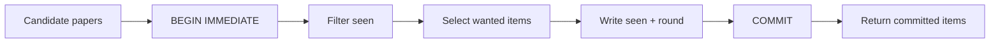

A session is a persistent deduplication set, not a user account or chat log. The random `session_id` held by the caller is also the access capability.

## Capability model

- A raw ID contains at least 256 bits of randomness.
- The raw ID is returned only at creation; the database stores only a SHA-256 hash.
- Anyone holding the raw ID can access that session.
- Anonymous interfaces cannot list, recover, or search other sessions.
- Closed, expired, and nonexistent sessions all return `session_not_found`.

Treat `session_id` like a temporary credential. Keep it out of logs, issues, screenshots, and public prompts.

## Atomic deduplication

Several requests may use one session concurrently. The implementation does not read the seen set and write it back later. A single SQLite transaction performs all steps:

Only papers actually returned are marked as seen. `get_papers` marks only found papers and only when a session is supplied.

## Lifecycle

The default idle TTL is 24 hours. Active sessions, total rounds, seen papers, audit records, and close summaries are bounded. When capacity is full, the service rejects a new session instead of evicting another caller's active session.

A new hit resets the consecutive-empty counter. Reaching the configured threshold marks the session `exhausted`, but the caller may still rephrase or adjust the window.

## Persisted data

Runtime SQLite stores the capability hash, label, timestamps, seen paper IDs, bounded round statistics, and query hashes. It stores no raw IP, raw query, or raw session ID. Labels are stored verbatim and must not contain sensitive information.
