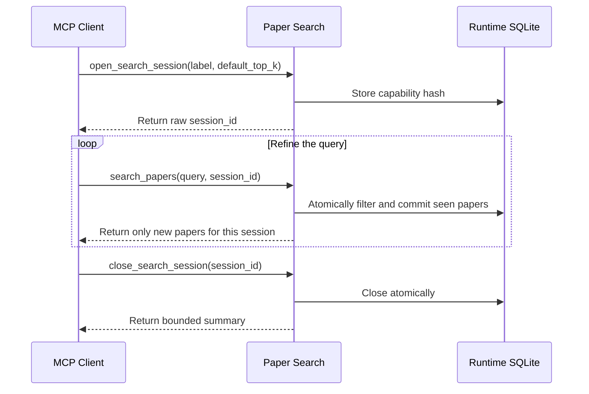

A session does not store chat history. It lets a related group of queries share the set of papers already returned.

## Complete flow



## 1. Open a session

```text
open_search_session(label="LLM inference optimization", default_top_k=8)
```

Save the returned `session_id` immediately. The service stores only its hash, so anonymous interfaces cannot recover the raw value.

## 2. Move from broad to specific queries

```text
search_papers(query="efficient LLM inference", session_id="...")
search_papers(query="speculative decoding", session_id="...")
search_papers(query="KV cache compression", session_id="...")
```

A paper that matches several queries is committed only once in this session. Different sessions remain isolated.

## 3. Decide when a direction is exhausted

Consecutive empty rounds mean only that the current fixed retrieval window contains no new papers. They do not prove that the corpus has no related work. Try, in order:

1. Change the concept, method name, or task wording.
2. Increase `search_depth` moderately.
3. Relax `area`, `paper_type`, or spotlight filters.
4. Close the session once the research goal is met.

## 4. Inspect and close

```text
search_session_status(session_id="...", include_papers=true)
close_search_session(session_id="...")
```

Closing invalidates the capability immediately. See [Capability Sessions](/en/docs/concepts/sessions) for lifecycle and concurrency details.
