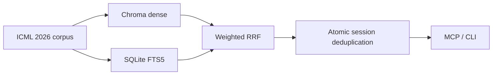

ICML Paper Search MCP provides local hybrid retrieval and persistent research sessions for 6,341 ICML 2026 papers. It is designed for AI agents that refine queries over multiple rounds, collect papers, and avoid repeated results, and it is also available through a CLI.

## At a glance



At runtime, the service contacts DashScope only when a query embedding misses the cache. Paper snapshots, vector indexes, BM25, and session state remain on the local machine.

## Choose a starting point

| Goal | Start here |
|---|---|
| Try the service now | [Connect to the public service](/en/docs/getting-started/public-service) |
| Run the complete stack yourself | [Local deployment](/en/docs/getting-started/local-deployment) |
| Complete a multi-round search | [Your first research session](/en/docs/getting-started/first-session) |
| Understand retrieval and deduplication | [System architecture](/en/docs/concepts/architecture) |
| Look up exact parameters | [MCP Tools Reference](/en/docs/reference/mcp-tools) |
| Deploy for production | [Docker deployment](/en/docs/operations/docker) |

## Project boundaries

- The current corpus is limited to ICML 2026; it does not include ICLR, NeurIPS, or other venues.
- This is a paper discovery tool, not a replacement for reading papers, reproducing experiments, or peer-review judgment.
- `score` is a fused ranking score for the current query, not a probability or a cross-query metric.
- The public service is anonymous and shares a bounded quota. Self-host when you need controlled capacity.
- Search queries are sent to DashScope and must not contain sensitive or unpublished information.

## Two ways to use it

The public service needs no API key and suits evaluation or lightweight research. Self-hosting uses your own DashScope key and gives you control over budgets, data paths, rate limits, and availability.

```bash
claude mcp add --transport http icml-papers --scope user \
  https://icml.agent4sci.com:20441/mcp
```

Continue with the [public-service quickstart](/en/docs/getting-started/public-service), or inspect the [MCP tool catalog](/en/docs/reference/mcp-tools).
