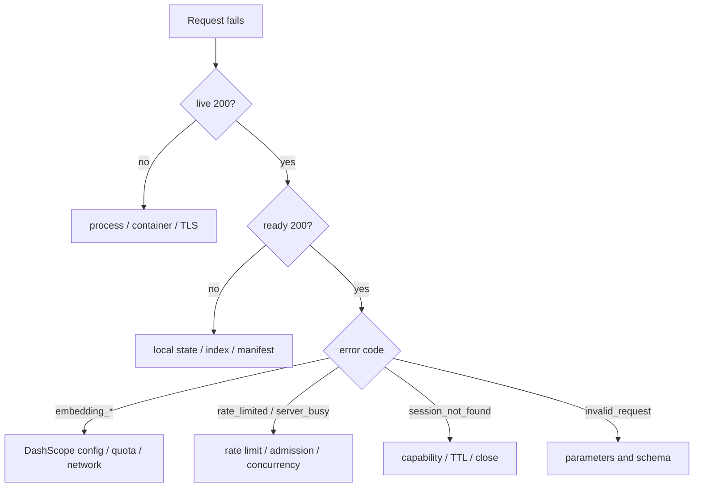

First determine whether the failure is in the process, local index, provider, or public governance boundary.



## `index_unavailable` or not ready

```bash
uv run icml-papers info
uv run icml-papers build
```

Check `current`, the manifest, source-corpus hashes, Chroma/FTS5 counts, and permissions. Default build is safe preflight; rebuild or restore only after finding the cause.

## Embedding failures

For `embedding_unavailable`, check the key, secret-file permissions, and access to the Beijing native API. A 401 or ordinary 403 usually indicates configuration; 429, 408, and 5xx are transient and already receive bounded retries. Never print the provider body or paste a key into a diagnostic command.

For `embedding_quota_exhausted`, check DashScope free quota, balance, identity verification, and free-tier-only settings. The error is non-retryable.

## `rate_limited` or `server_busy`

Shared NAT can make several callers consume one IP quota. Reduce concurrency and back off. Administrators should inspect rate buckets, admission, worker latency, and provider semaphores before raising limits.

## Session errors

`session_not_found` intentionally hides whether an ID is wrong, expired, or closed. Confirm that the client saved the business `session_id`, did not substitute the MCP transport session, and did not reuse a closed capability.

## Host or Origin rejection

Verify the external URL, TLS certificate, proxy Host, `allowed_hosts`, and `allowed_origins`. The application reads a proxy identity header only when trusted proxy mode is enabled and the peer belongs to an allowed network.

## Browser access to `/mcp` returns 406

`/mcp` is a Streamable HTTP MCP endpoint, not a web page. HTTP 406 with `Client must accept text/event-stream` is expected when a browser or incompatible client omits the required `Accept` value.

- Check the process at `/health/live`.
- Check local index/state at `/health/ready`.
- Call tools through a Streamable HTTP MCP client whose SDK performs POST `initialize`, dual-media-type `Accept`, `Mcp-Session-Id`, and subsequent requests.

Do not use the transport `Mcp-Session-Id` as the capability session returned by `open_search_session`.

## Build cannot resume

Compare the preflight build ID, corpus hash, model, dimension, and batch size. If a usage failure audit exists or completed IDs are not a strict prefix, preserve the audit, move staging aside, and start a new preflight.
