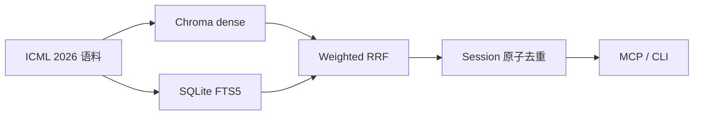

ICML Paper Search MCP 为 6,341 篇 ICML 2026 论文提供本地混合检索和持久化调研会话。它面向需要连续换词、收集论文、避免重复结果的 AI agent，也可以通过 CLI 直接使用。

## 一眼理解



系统运行时只在 query embedding 未命中缓存时访问 DashScope。论文快照、向量索引、BM25 和 session state 都保存在本机。

## 从哪里开始

| 目标 | 入口 |
|---|---|
| 立即试用 | [连接公共服务](/docs/getting-started/public-service) |
| 完整自托管 | [本地部署](/docs/getting-started/local-deployment) |
| 完成第一次多轮调研 | [第一个调研会话](/docs/getting-started/first-session) |
| 理解检索与去重 | [系统架构](/docs/concepts/architecture) |
| 查询精确参数 | [MCP Tools Reference](/docs/reference/mcp-tools) |
| 生产部署 | [Docker 部署](/docs/operations/docker) |

## 项目边界

- 当前语料固定为 ICML 2026，不包含 ICLR、NeurIPS 或其他会议。
- 它是论文发现工具，不替代阅读全文、复现实验或同行评审判断。
- `score` 是当前 query 内的融合排名分，不是概率或跨 query 指标。
- 公共服务匿名且有共享额度；需要稳定容量时应自托管。
- 论文 query 会发送到 DashScope，不应用于敏感或未公开内容。

## 两种使用方式

公共服务无需 key，适合试用和轻量研究；自托管需要自己的 DashScope key，但可以控制预算、数据目录、限流和可用性。

```bash
claude mcp add --transport http icml-papers --scope user \
  https://icml.agent4sci.com:20441/mcp
```

接下来阅读[公共服务快速开始](/docs/getting-started/public-service)，或直接查看 [MCP 工具清单](/docs/reference/mcp-tools)。
