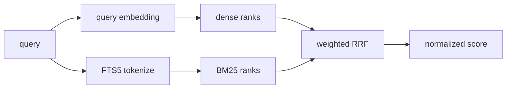

论文发现同时需要“概念相近”和“词面精确”。系统对每个 query 各执行一次 dense 与 BM25 召回，再用 weighted reciprocal rank fusion 合并名次。

## 双路召回

- **Dense**：DashScope 生成 query embedding，Chroma COSINE 找语义相近论文。
- **BM25**：SQLite FTS5 对题目、摘要和元数据做词项匹配。
- **过滤**：`area`、`paper_type`、spotlight 在两路召回中保持一致。

默认权重是 dense `0.8`、BM25 `0.2`，`rrf_k=60`。权重之和必须为 1，并被写入索引 manifest。

## 固定检索窗口

默认 `search_depth = top_k × 4`，且不超过全局上限。每一路只召回一次；session 去重在融合后的固定窗口中执行，不会自动深入弱相关区域补满 `top_k`。

例如 `top_k=5, search_depth=20`，同一 query 连续调用可能依次返回窗口中的 1–5、6–10、11–15、16–20，之后为空。

这项设计让每次调用的成本、延迟和相关性边界可预测。新结果不足时，调用方应换词、增大 `search_depth` 或结束当前方向。

## 如何理解 score

`score` 是融合排名经过归一化后的 `[0,1]` 数值：

- 可用于当前结果内排序。
- 可用于 `min_score` 粗过滤。
- 不是余弦相似度。
- 不是论文相关概率。
- 不适合直接比较两个不同 query 的绝对数值。

筛选策略见[过滤与结果解释](/zh/docs/guides/filters-and-scoring)。
