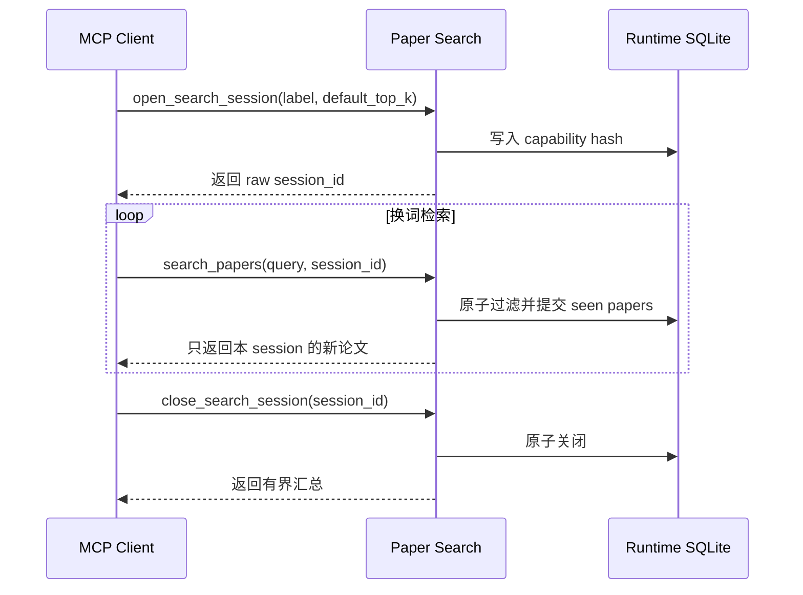

Session 的目的不是保存聊天记录，而是让一组相关 query 共享“已经返回过哪些论文”的集合。

## 完整流程



## 1. 创建 session

```text
open_search_session(label="LLM inference optimization", default_top_k=8)
```

立即保存返回的 `session_id`。服务端只保存摘要，匿名接口无法替你找回原值。

## 2. 从宽到窄换词

```text
search_papers(query="efficient LLM inference", session_id="...")
search_papers(query="speculative decoding", session_id="...")
search_papers(query="KV cache compression", session_id="...")
```

同一篇论文即使匹配多个 query，也只会在这个 session 中提交一次。不同 session 之间互不影响。

## 3. 判断是否接近挖尽

连续空轮只表示当前 query 的固定召回窗口里没有新论文，不表示整个语料不存在相关论文。依次尝试：

1. 更换概念、方法名或任务名。
2. 适度增大 `search_depth`。
3. 放宽 `area`、`paper_type` 或 spotlight 过滤。
4. 达到调研目标后关闭 session。

## 4. 检查并关闭

```text
search_session_status(session_id="...", include_papers=true)
close_search_session(session_id="...")
```

关闭后 capability 立即失效。详细生命周期和并发语义见 [Capability Session](/zh/docs/concepts/sessions)。
