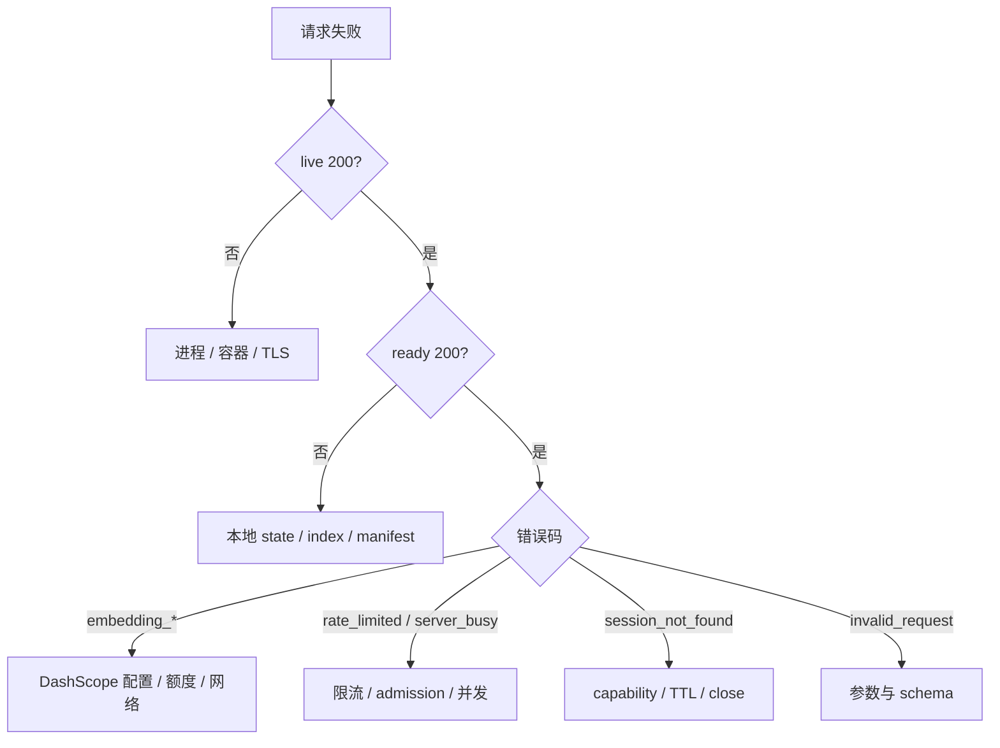

先判断问题发生在进程、本地索引、provider，还是公共治理边界。



## `index_unavailable` 或 not ready

```bash
uv run icml-papers info
uv run icml-papers build
```

检查 `current`、manifest、原始语料 hash、Chroma/FTS5 记录数和文件权限。默认 build 是安全 preflight；确认原因后再决定重建或恢复。

## `embedding_unavailable`

检查 key 是否配置、secret 文件是否可读、网络是否能访问北京地域 native API。401/普通 403 多为配置错误，429/408/5xx 属于瞬态故障；服务端已执行有界重试。

不要输出 provider body 或把 key 粘贴进诊断命令。

## `embedding_quota_exhausted`

检查 DashScope 免费额度、账户余额、实名认证和“免费额度用完即停”设置。该错误不可重试，继续并发调用只会制造噪声。

## `rate_limited` / `server_busy`

共享 NAT 可能让多个调用方共用 IP 额度。降低并发并退避；管理员检查 rate bucket、admission、worker latency 和 provider semaphore，不先扩大所有上限。

## Session 异常

`session_not_found` 同时隐藏错误 id、过期和已关闭状态。确认客户端保存的是业务 `session_id`，没有把 MCP transport session id 混入，也没有在 close 后继续使用。

## Host / Origin 拒绝

确认外部 URL、TLS 证书、代理 Host、`allowed_hosts` 与 `allowed_origins` 完全一致。只有启用 trusted proxy 且 peer 在可信网段时，应用才读取代理身份 header。

## 浏览器访问 `/mcp` 返回 406

`/mcp` 是 Streamable HTTP MCP endpoint，不是网页。浏览器或不合规客户端未声明 `Accept: text/event-stream` 时，SDK 返回 HTTP 406 和 `Client must accept text/event-stream` 是预期行为。

- 人工检查进程：访问 `/health/live`。
- 检查本地 index/state：访问 `/health/ready`。
- 调用工具：使用支持 Streamable HTTP 的 MCP 客户端，让 SDK 完成 POST `initialize`、双媒体类型 `Accept`、`Mcp-Session-Id` 和后续请求。

不要把 transport 的 `Mcp-Session-Id` 当作 `open_search_session` 返回的 capability session id。

## 建库无法 resume

比较 preflight build id、语料 hash、模型、维度和 batch size。存在 usage failure audit 或 completed ids 不是严格前缀时，保留审计后移走 staging，重新预检构建。
